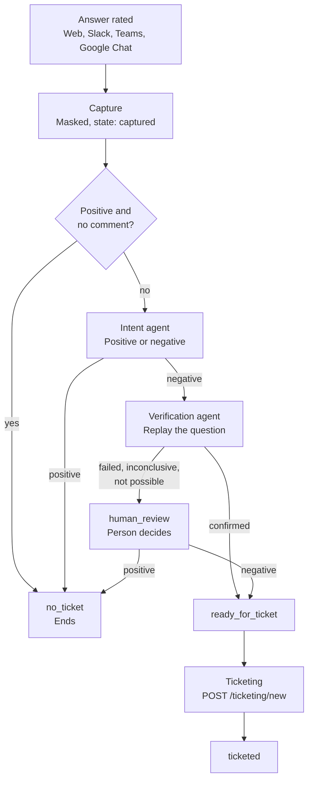
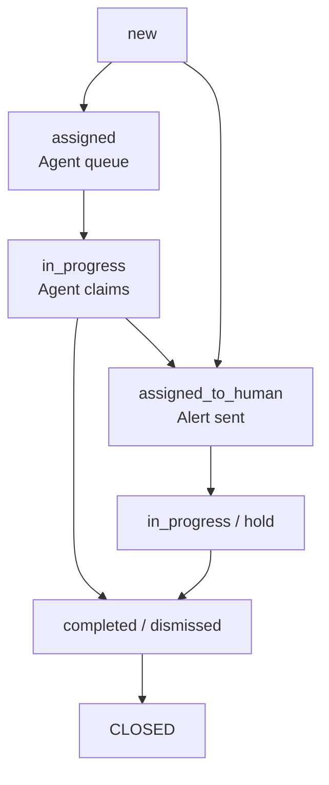

# Working on this repository (Claude Code)

The build plan is `../docs/development-plan-v4_3-release-2 1.md` (Release 2), on top of the v3 plan. Its Part A rules apply to
every change:

- **One core path.** Presenters only format. Every button click goes through `app/channels/core.handle_action()`, and a
  suggestion click becomes an ordinary `core.handle()` question.
- **Settings, not code branches.** Features are switched and tuned through `app/scoped_settings.py`: channel, then KB, then
  department, then global. Each key declares the scopes it allows. The defaults are safe: new features are off.
- **Search text is separate from question text.** Only the search changes, through the glossary or the router. The question
  in the prompt, the memory, the answer and the trace stays as the person wrote it.
- **Permissions first.** Glossary expansion, suggestions and traces use the asker's allow-list (`app/knowledge/access.py`),
  with no bypass.
- **Privacy.** Masking runs on its own switch (D36). Traces store references, not passage text. Suggestions are stored masked.
  Free text never goes into logs or audit details.
- **Code-owned prompt text.** Anything the code parses (the not-found marker, the suggestion block, the language directive)
  lives in code, never in an editable prompt.
- **Signed payloads** (D37), with a key derived from `APP_SECRET_KEY`.

How work is done here:
- One branch per phase (`r2/phase-<n>-<topic>`).
- Tests on SQLite and PostgreSQL (`TEST_DB=postgres`, which needs Docker).
- A Phase Report in `PROGRESS.md`, and decisions and deviations in `DECISIONS.md`.
- Stop for review after each phase.
- Commit, push and deploy only when asked. Never commit `.env`, `admin_data/` or `models/`.

## Release 3 addendum (from `docs/development-plan-v5-release-3-feedback-ticketing.md`, Part A)

### A1. Scope amendments (Release 2 and v3)

| Earlier plans say | Release 3 says |
| --- | --- |
| Conversations are masked and bound by retention | Extended: feedback comments are masked before they are stored. Attachments are stored as links only, never as content. Ticket evidence is a masked snapshot |
| The trace stores references, not rendered prompts or passage text | Unchanged. Replay uses the trace's prompt version ids, standalone query and model. Passage text is still fetched only for viewers who may see the document |
| Nothing changes configuration without an Admin | Exception: the admin agent, limited to three fixes, each enforced in code. KB setting changes need human approval (D57) |
| One preferred model serves every step | Unchanged. New usage purposes: `fb_intent`, `fb_replay`, `fb_ticket`, `fb_admin` |
| Documents are never altered | Unchanged. Re-ingesting a file rebuilds its chunks from the same file. It does not change the file |
| No quarantine or alerting from ratings | Unchanged. This release raises tickets and alerts people about tickets only |

### A2. Feedback workflow

**Feedback states:** `captured`, `no_ticket`, `human_review`, `ready_for_ticket`, `ticketed`.

1. **Capture.** The rater uses a control in the channel (Web, Slack, Teams, Google Chat). The signed payload (D37) names the answer. The system:
   - finds the answer (`answer_id`) and its conversation;
   - masks the comment and stores attachments as links only;
   - creates or updates the feedback record: rating, reason, comment, channel, KB id, answer id, state `captured`.
2. **Decision at capture.** A positive rating with no comment sets intent to positive and state to `no_ticket`, and processing ends. Anything else stays `captured` and is picked up by the main feedback agent.
3. **Intent (intent agent).**
   - With a reason or comment: classify as positive or negative, and write a short issue summary.
   - A plain thumbs-down: read the trace, the cited documents and the retrieval results, then mark it negative with an issue summary.
   - Positive: `no_ticket`, processing ends.
4. **Replay verification (verification agent).** Load the original question and the conversation context. Replay it with the same prompt versions and the rater's **current** permissions. Outcomes:
   - **Confirmed:** the same problem is reproduced. State `ready_for_ticket`.
   - **Failed:** the problem no longer reproduces; the answer is now correct. State `human_review`.
   - **Inconclusive:** errors or too little evidence. State `human_review`.
   - **Not possible:** a cited document was changed or deleted, or the rater's access changed. State `human_review`.
5. **Human review.** The reviewer sees the question, the answer, the comment, the issue summary and the replay result. Positive: `no_ticket`. Negative: `ready_for_ticket`.
6. **Handover.** For every `ready_for_ticket`, call the ticketing service (`POST /ticketing/new`, D55), save the ticket id on the feedback, and set `ticketed`.

### A3. Ticket workflow

**Ticket statuses** (the event names in `ticket_events`): `new`, `assigned`, `in_progress`, `assigned_to_human`, `hold`, `completed`, `dismissed`, `reopened`. CLOSED means the status is `completed` or `dismissed`. The `reopened` event exists in your schema but is **not used** in this release: every ticket is new, and a closed ticket stays closed.

**Creation (`POST /ticketing/new`).**
- Input: type `Feedback`, feedback id, KB id, evidence (question, answer, cited documents, user comment), raised by.
- **Always a new ticket** (D55). No matching against earlier tickets, no reopening and no other checks for now. Two feedbacks on the same problem make two tickets.
- Status `new`, with evidence and metadata. Then assign to the autonomous queue (`assigned`) or to a person or group (`assigned_to_human`, with an alert).
- Response: `{ "outcome": "new", "ticket_id": "xxxx" }`. The `outcome` field stays, so the later add-on can add values without changing the contract.

**Allowed transitions** (enforced in code; every change writes a `ticket_events` row and updates `tickets.status` in one transaction):

| From | To | By |
| --- | --- | --- |
| (none) | `new` | system |
| `new` | `assigned`, `assigned_to_human` | assignment rules |
| `assigned` | `in_progress` (the claim) | admin agent |
| `assigned` | `assigned_to_human` | Admin (reassign) |
| `in_progress` | `completed`, `dismissed` | admin agent or human |
| `in_progress` | `assigned_to_human` | admin agent (cannot resolve, or approval needed) |
| `assigned_to_human` | `in_progress`, `hold` | the assignee |
| `hold` | `in_progress` | the assignee |
| `in_progress` (human) | `hold`, `completed`, `dismissed` | the assignee |

### A4. The admin agent loop

1. **Claim.** An atomic change from `assigned` to `in_progress`. Only one runner can win. The event records the actor as autonomous.
2. **Diagnose.** Read the evidence and the trace. Look at similar past tickets in the same KB, their fixes and outcomes. Decide on one allowed fix, or none.
3. **Allowed fixes (code allow-list):**
   - re-ingest the affected file;
   - update KB settings, which needs human approval;
   - add or update glossary entries.

   No valid fix: `assigned_to_human` with the diagnosis in the note.
4. **Apply.** Read the current value (before), make the change, validate it (after). On any error, roll back to the before value and reassign to a human.
5. **Complete.** `completed` or `dismissed`. The event's `detail` stores the diagnosis, the action, the before and after values, and `rolled_back`.
6. **No automatic post-fix check**, and no reopen signal for now (D59).

### A5. Standards (every phase)

- **One core path.** Presenters only format. Every rating click goes through `core.handle_action()`. The pipeline's own writes (state changes, ticket changes) go through one function each, so the rules cannot be bypassed.
- **Settings, not code branches.** Every feature is switched and tuned through scoped settings, hot-reloaded and audited. All new features are **off by default**. Each setting declares which scopes may override it.
- **Permissions first.** Replay, the trace views and the ticket screens use the same allow-list as Release 2. The replay uses the rater's current access. Nobody gets a bypass.
- **Privacy.** Comments and evidence are masked before storage. Free text is never written to logs. Attachments are links only.
- **Agent input is untrusted.** A user's comment, a question, an answer and a document can all contain instructions aimed at an agent. Agents treat them as data. Every tool call is validated in code against the allow-list, the ticket's own KB and the schema, so a fooled model still cannot step outside its limits. Tests include injection text in comments and documents.
- **Agent runtime (D51).** One small shared runtime for all agents: a bounded loop, a tool allow-list per agent, a step cap, a token ceiling and a timeout per run, a kill switch per agent, and usage records with the agent's purpose. A failed or timed-out agent run sends the item to a human. It never leaves it stuck.
- **Idempotency.** Capture, handover and every agent step can be run twice without a second effect.
- **Code-owned prompt text.** Agent prompts and their output formats live in code and are versioned with it. Admins cannot edit them.
- **Signed interactive payloads** (D37), reused for the rating controls.

### A6. Data model (Alembic, upgrade in place, numbered from the next free migration number; confirm it)

Tables marked "your schema" come from the schema you added. I could read `tickets` (as an image) and `ticket_events` (as a CSV), and the seed values of the ticket types. I could not see `feedbacks`, `ticket_types` or `ticket_groups` in full, so their fields below are assumptions to compare with your schema.

| Table / change | Key fields | Phase |
| --- | --- | --- |
| `feedbacks` (assumed) | `answer_id` (assistant message id), `user_id`, `kb_id`, `channel`, `rating`, `reason`, `comment` (masked), `attachments` (JSON links), `intent` (positive/negative, NULL), `intent_source` (rating/comment/trace), `summary`, `state`, `verification` (JSON: outcome, reason, masked replay answer, config snapshot compared), `reviewer_id`, `reviewed_at`, `review_note`, `ticket_id` (NULL until ticketed), audit columns | 1 (capture), 3 (the rest) |
| `ticket_types` (your schema) | Seeded: `data_mismatch`, `data_not_found`, `data_not_access`, `experience`, `other` | 2 |
| `ticket_groups` (your schema) | Created, not used in this release (D56) | 2 |
| `tickets` (your schema) | `type_id`, `ref_id` (first feedback id), `kb_id`, `category`, `title` (masked), `evidence` (masked JSON), `status`, `group_id`, `assignee_type` (autonomous/user/group), `assignee_id`, `raised_by`, audit columns | 2 |
| `ticket_events` (your schema) | `ticket_id`, `event`, `actor_type` (autonomous/manual), `actor_id` (NULL when autonomous), `note`, `detail` (JSON: diagnosis, action, before, after, rolled_back). Rows are never updated | 2 |
| `messages` (check) | If the channel's own message id for an answer is not already stored, add it so a click in a chat app can find its answer | 1 |

- **Retention (D49).** A feedback row is deleted with its conversation. A ticket keeps its masked evidence for `ticket_retention_days` (a Global Setting), so an open or recent ticket survives the conversation it came from. `ref_id` is allowed to point at a deleted feedback.
- **Usage purposes** `fb_intent`, `fb_replay`, `fb_ticket` and `fb_admin` fit the existing 32-character column.

### A7. Decisions (record in DECISIONS.md; all Proposed)

| ID | Question | Default |
| --- | --- | --- |
| D48 | Release scope | Per A1 and the table at the top. Grouping tickets (`ticket_groups`, `group_id`) is not built in this release. Reopening, matching against earlier tickets, `high_risk` escalation and ticket classification are also left for a later add-on |
| D49 | Feedback record and retention | One record per rater and answer, updated while the state is `captured`, `no_ticket` or `human_review`. A rating after `ticketed` is a new record, and a negative one becomes a new ticket. Comments are masked before storage, attachments are links only. A feedback is deleted with its conversation. Tickets keep their masked evidence for `ticket_retention_days` |
| D50 | Who can rate | Only the person who asked the question, as for suggestion clicks (D37). Controls expire with the payload (default 14 days). Reasons come from the ticket type seed values, assumed to be the same five (confirm) |
| D51 | Agent runtime and roster | Per A5. The main feedback agent is a rule-driven orchestrator: it never chooses a state by model output, it only reads the results of the other agents. The ticketing agent is limited to writing the title and summary |
| D52 | Intent | A comment that is unclear or mixed is treated as negative, because replay or a person checks it next. Thumbs-down with no comment is negative. The issue summary is written by this agent, masked, and shown to the reviewer and the ticket |
| D53 | Replay and "not possible" | The replay runs the normal answer pipeline in a replay mode: no message saved, no trace, no suggestions, no rate limit, the trace's prompt version ids, and the rater's **current** allow-list and current settings. Usage is recorded as `fb_replay`. "Not possible" is decided before any model call: a cited document is missing or was updated after the answer, the rater can no longer see a cited document, or the KB or a pinned prompt version is gone. Release 2 dropped the document version and allow-list signature from the trace, and this release does not bring them back. It uses the document's update time and a fresh access check instead. The result also records whether the settings snapshot differs from the one in the original trace, so a reviewer can see why an answer changed. One replay per answer, cached. A daily cap sends the overflow to human review |
| D54 | Human review | The queue shows each item once, with a claim lock. Reviewers are Admins, and Editors for their own department's KBs. The reviewer's decision, name and note are stored. The share of replay results that a reviewer overturns is reported, as it is the main measure of agent quality |
| D55 | Ticket creation | `POST /ticketing/new` is internal (the pipeline and Admins). It is idempotent per feedback id, so the same feedback never makes two tickets. **Every ticket is new.** For now there is no matching against earlier tickets, no reopening, no `reopen_count`, no `high_risk` and no escalation rules. These wait for the later classification add-on. The response keeps an `outcome` field, always `new`, so the add-on can extend it |
| D56 | Ticket state machine | Per A3. `tickets.status` always equals the latest event. Events are never updated or deleted. The `reopened` event stays in the schema and is unused |
| D57 | Admin agent: allowed fixes | A code allow-list of three actions. **Re-ingest:** a single file, validated by status Indexed and a non-zero chunk count. **Glossary:** a new version with the term, validated by the conflicts report and the expansion test; rollback is republishing the previous version. **KB settings:** the agent only writes a proposal (key, scope, before, proposed) and hands the ticket to a human. On approval the same apply-and-validate routine runs, with the approver as the actor. Setting keys outside an Admin-approved list are refused. Each fix goes through the Admin APIs, as MCP tools if the project already has an MCP layer, so permission checks, validation and audit are the same as for a person |
| D58 | Notifications | `assigned_to_human` sends an alert to the assignee or group through a notifier adapter. The first implementation reuses the existing alert or email mechanism if there is one, and also shows on the Admin screen |
| D59 | Quality signal | No automatic post-fix check, and no reopen signal for now. The reports show what the agent completed, dismissed and handed to a person, by fix type, plus the share of replay results that reviewers overturn. Reopening and classification come later |
| D60 | Rollout modes | `feedback_processing_mode`: `off`, `review_all` (every non-positive feedback goes to human review) or `auto`. `admin_agent_mode`: `off`, `shadow` (the agent diagnoses and records what it would do, and changes nothing) or `live`. The defaults are `off` |

### A8. Role capabilities

| Capability | Admin | Editor | Viewer |
| --- | --- | --- | --- |
| Rate an answer they asked | Yes | Yes | Yes |
| View feedback | Any | Own department's KBs | No |
| Human review of feedback | Any | Own department's KBs | No |
| View and work tickets | Any | Own department's KBs | No |
| Reassign a ticket | Any | Own department | No |
| Approve a KB setting proposal | Any | Own department's KBs, for keys allowed at that scope | No |
| Feedback, ticket and agent settings | Any | Own department, where the registry allows | No |
| Switch agent modes, view agent reports | Yes | No | No |
