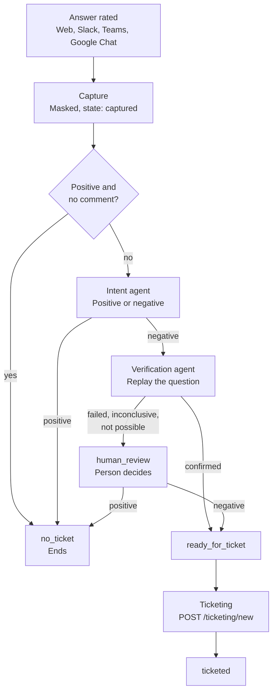
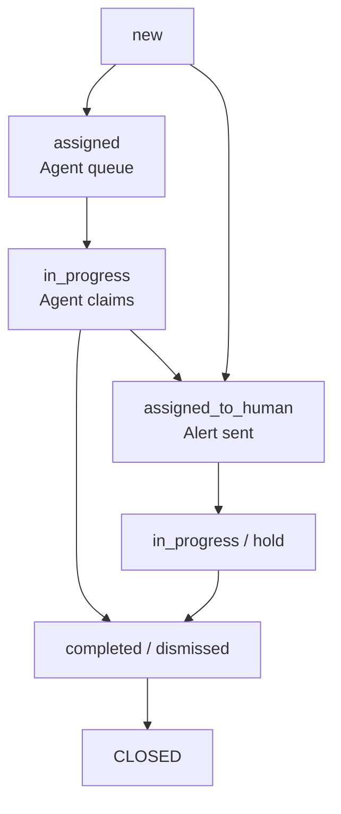

# Development Plan v5 (Release 3): Feedback, Ticketing and the Autonomous Admin Agent

**Status:** draft for review. **Date:** 2026-11-04. **Builds on:** Development Plan v4.3 (Release 2), all four phases delivered: trace, scoped settings, multilingual answers, document summaries, glossary, suggestions and the release checklist.

**Format:** same as v4.3. Part A is the addendum to CLAUDE.md, and Part B covers one phase at a time, each ending with a Phase Report. Decisions go into `DECISIONS.md`. New IDs start at **D48** and stay Proposed until confirmed. The IDs removed in v4.3 (D24, D25, D27, D28, D32, D38, D41 to D45) are not reused, and this design replaces the feedback design in v4.2.

## What this release adds

A user rates an answer. The system checks whether the complaint is real, raises a new ticket, and an autonomous admin agent tries one of three approved fixes. A human takes over whenever the agent cannot or should not act.

Five agents take part. Everything else is plain code, so the flow stays predictable and testable.

| Agent | Job | Where |
| --- | --- | --- |
| Main feedback agent | Orchestrator. Owns the feedback record and its state, calls the other agents in order, routes to human review, hands over to ticketing. Transitions follow fixed rules, not model choice | Phase 3 |
| Intent agent | Classifies feedback as positive or negative. For a plain thumbs-down it reads the trace instead | Phase 3 |
| Verification agent | Replays the question, then judges whether the problem is confirmed | Phase 3 |
| Ticketing agent | Writes the ticket title and the evidence summary. No matching or other checks for now | Phase 2 |
| Admin agent | Diagnoses a ticket and applies one approved fix, with before and after checks and rollback | Phase 4 |

**Not agents:** feedback capture, masking, the ticket state machine, assignment rules and rollback.

## 0. How this plan is run

- This file goes into `/docs` next to the v4.3 plan, and Part A is appended to `CLAUDE.md`.
- I (Claude) build it one phase at a time, in the order of Part B. Each phase ends with:
  - a Phase Report in `PROGRESS.md`;
  - decisions and deviations in `DECISIONS.md`;
  - the full test suite green on SQLite and PostgreSQL.
- **I stop after every Phase Report** for your review. Committing, pushing, the Cloud Build and the UAT deploy happen only once you say so. You run the deploy script, as today.
- Each phase is built on its own branch (`r3/phase-<n>-<topic>`) and merged after review.
- Anything here that turns out to be wrong against the code or the schema is recorded as a deviation, not silently changed.
- **Why four phases:** fewer would mix work of very different risk (the admin agent changes configuration; capture does not). More would split things that cannot be tested alone. Integration and hardening is a release checklist after Phase 4, as in Release 2.

### Human prerequisites (none are code)

| Needed for | What a person must do | Lead-time risk |
| --- | --- | --- |
| Phase 1 | Privacy sign-off for storing comments, attachment links and ticket evidence, including how long tickets outlive their conversation (D49, D55) | Medium |
| Phase 1 | Slack, Teams and Google Chat: the interactive features from Release 2 are already on. Confirm the rating controls need no new scopes or approvals (comment entry may need a modal or dialog) | Medium for Teams |
| Phase 2 | Name the groups or people who receive `assigned_to_human` tickets per department, and the alert channel (D58) | Low |
| Phase 3 | At least 30 real feedback cases, labelled by a person as positive or negative and "real problem" or "not a problem", in the languages that matter. For the spikes | Medium |
| Phase 4 | Admin agrees the allow-list of KB setting keys the agent may propose changes to, and who approves them (D57) | Low |
| Phase 4 | At least 20 resolved tickets (real, or written by hand) with the fix that worked, for the diagnosis spike | Medium |
| All | Test users for Admin, Editor and Viewer in two departments | Low |

---

# PART A: ADDENDUM TO CLAUDE.md

## A1. Scope amendments (Release 2 and v3)

| Earlier plans say | Release 3 says |
| --- | --- |
| Conversations are masked and bound by retention | Extended: feedback comments are masked before they are stored. Attachments are stored as links only, never as content. Ticket evidence is a masked snapshot |
| The trace stores references, not rendered prompts or passage text | Unchanged. Replay uses the trace's prompt version ids, standalone query and model. Passage text is still fetched only for viewers who may see the document |
| Nothing changes configuration without an Admin | Exception: the admin agent, limited to three fixes, each enforced in code. KB setting changes need human approval (D57) |
| One preferred model serves every step | Unchanged. New usage purposes: `fb_intent`, `fb_replay`, `fb_ticket`, `fb_admin` |
| Documents are never altered | Unchanged. Re-ingesting a file rebuilds its chunks from the same file. It does not change the file |
| No quarantine or alerting from ratings | Unchanged. This release raises tickets and alerts people about tickets only |

## A2. Feedback workflow

**Feedback states:** `captured`, `no_ticket`, `human_review`, `ready_for_ticket`, `ticketed`.

1. **Capture.** The rater uses a control in the channel (Web, Slack, Teams, Google Chat). The signed payload (D37) names the answer. The system:
   - finds the answer (`answer_id`) and its conversation;
   - masks the comment and stores attachments as links only;
   - creates or updates the feedback record: rating, reason, comment, channel, KB id, answer id, state `captured`.
2. **Decision at capture.** A positive rating with no comment sets intent to positive and state to `no_ticket`, and processing ends. Anything else stays `captured` and is picked up by the main feedback agent.
3. **Intent (intent agent).**
   - With a reason or comment: classify as positive or negative, and write a short issue summary.
   - A plain thumbs-down: read the trace, the cited documents and the retrieval results, then mark it negative with an issue summary.
   - Positive: `no_ticket`, processing ends.
4. **Replay verification (verification agent).** Load the original question and the conversation context. Replay it with the same prompt versions and the rater's **current** permissions. Outcomes:
   - **Confirmed:** the same problem is reproduced. State `ready_for_ticket`.
   - **Failed:** the problem no longer reproduces; the answer is now correct. State `human_review`.
   - **Inconclusive:** errors or too little evidence. State `human_review`.
   - **Not possible:** a cited document was changed or deleted, or the rater's access changed. State `human_review`.
5. **Human review.** The reviewer sees the question, the answer, the comment, the issue summary and the replay result. Positive: `no_ticket`. Negative: `ready_for_ticket`.
6. **Handover.** For every `ready_for_ticket`, call the ticketing service (`POST /ticketing/new`, D55), save the ticket id on the feedback, and set `ticketed`.

## A3. Ticket workflow

**Ticket statuses** (the event names in `ticket_events`): `new`, `assigned`, `in_progress`, `assigned_to_human`, `hold`, `completed`, `dismissed`, `reopened`. CLOSED means the status is `completed` or `dismissed`. The `reopened` event exists in your schema but is **not used** in this release: every ticket is new, and a closed ticket stays closed.

**Creation (`POST /ticketing/new`).**
- Input: type `Feedback`, feedback id, KB id, evidence (question, answer, cited documents, user comment), raised by.
- **Always a new ticket** (D55). No matching against earlier tickets, no reopening and no other checks for now. Two feedbacks on the same problem make two tickets.
- Status `new`, with evidence and metadata. Then assign to the autonomous queue (`assigned`) or to a person or group (`assigned_to_human`, with an alert).
- Response: `{ "outcome": "new", "ticket_id": "xxxx" }`. The `outcome` field stays, so the later add-on can add values without changing the contract.

**Allowed transitions** (enforced in code; every change writes a `ticket_events` row and updates `tickets.status` in one transaction):

| From | To | By |
| --- | --- | --- |
| (none) | `new` | system |
| `new` | `assigned`, `assigned_to_human` | assignment rules |
| `assigned` | `in_progress` (the claim) | admin agent |
| `assigned` | `assigned_to_human` | Admin (reassign) |
| `in_progress` | `completed`, `dismissed` | admin agent or human |
| `in_progress` | `assigned_to_human` | admin agent (cannot resolve, or approval needed) |
| `assigned_to_human` | `in_progress`, `hold` | the assignee |
| `hold` | `in_progress` | the assignee |
| `in_progress` (human) | `hold`, `completed`, `dismissed` | the assignee |

## A4. The admin agent loop

1. **Claim.** An atomic change from `assigned` to `in_progress`. Only one runner can win. The event records the actor as autonomous.
2. **Diagnose.** Read the evidence and the trace. Look at similar past tickets in the same KB, their fixes and outcomes. Decide on one allowed fix, or none.
3. **Allowed fixes (code allow-list):**
   - re-ingest the affected file;
   - update KB settings, which needs human approval;
   - add or update glossary entries.

   No valid fix: `assigned_to_human` with the diagnosis in the note.
4. **Apply.** Read the current value (before), make the change, validate it (after). On any error, roll back to the before value and reassign to a human.
5. **Complete.** `completed` or `dismissed`. The event's `detail` stores the diagnosis, the action, the before and after values, and `rolled_back`.
6. **No automatic post-fix check**, and no reopen signal for now (D59).

## A5. Standards (every phase)

- **One core path.** Presenters only format. Every rating click goes through `core.handle_action()`. The pipeline's own writes (state changes, ticket changes) go through one function each, so the rules cannot be bypassed.
- **Settings, not code branches.** Every feature is switched and tuned through scoped settings, hot-reloaded and audited. All new features are **off by default**. Each setting declares which scopes may override it.
- **Permissions first.** Replay, the trace views and the ticket screens use the same allow-list as Release 2. The replay uses the rater's current access. Nobody gets a bypass.
- **Privacy.** Comments and evidence are masked before storage. Free text is never written to logs. Attachments are links only.
- **Agent input is untrusted.** A user's comment, a question, an answer and a document can all contain instructions aimed at an agent. Agents treat them as data. Every tool call is validated in code against the allow-list, the ticket's own KB and the schema, so a fooled model still cannot step outside its limits. Tests include injection text in comments and documents.
- **Agent runtime (D51).** One small shared runtime for all agents: a bounded loop, a tool allow-list per agent, a step cap, a token ceiling and a timeout per run, a kill switch per agent, and usage records with the agent's purpose. A failed or timed-out agent run sends the item to a human. It never leaves it stuck.
- **Idempotency.** Capture, handover and every agent step can be run twice without a second effect.
- **Code-owned prompt text.** Agent prompts and their output formats live in code and are versioned with it. Admins cannot edit them.
- **Signed interactive payloads** (D37), reused for the rating controls.

## A6. Data model (Alembic, upgrade in place, numbered from the next free migration number; confirm it)

Tables marked "your schema" come from the schema you added. I could read `tickets` (as an image) and `ticket_events` (as a CSV), and the seed values of the ticket types. I could not see `feedbacks`, `ticket_types` or `ticket_groups` in full, so their fields below are assumptions to compare with your schema.

| Table / change | Key fields | Phase |
| --- | --- | --- |
| `feedbacks` (assumed) | `answer_id` (assistant message id), `user_id`, `kb_id`, `channel`, `rating`, `reason`, `comment` (masked), `attachments` (JSON links), `intent` (positive/negative, NULL), `intent_source` (rating/comment/trace), `summary`, `state`, `verification` (JSON: outcome, reason, masked replay answer, config snapshot compared), `reviewer_id`, `reviewed_at`, `review_note`, `ticket_id` (NULL until ticketed), audit columns | 1 (capture), 3 (the rest) |
| `ticket_types` (your schema) | Seeded: `data_mismatch`, `data_not_found`, `data_not_access`, `experience`, `other` | 2 |
| `ticket_groups` (your schema) | Created, not used in this release (D56) | 2 |
| `tickets` (your schema) | `type_id`, `ref_id` (first feedback id), `kb_id`, `category`, `title` (masked), `evidence` (masked JSON), `status`, `group_id`, `assignee_type` (autonomous/user/group), `assignee_id`, `raised_by`, audit columns | 2 |
| `ticket_events` (your schema) | `ticket_id`, `event`, `actor_type` (autonomous/manual), `actor_id` (NULL when autonomous), `note`, `detail` (JSON: diagnosis, action, before, after, rolled_back). Rows are never updated | 2 |
| `messages` (check) | If the channel's own message id for an answer is not already stored, add it so a click in a chat app can find its answer | 1 |

- **Retention (D49).** A feedback row is deleted with its conversation. A ticket keeps its masked evidence for `ticket_retention_days` (a Global Setting), so an open or recent ticket survives the conversation it came from. `ref_id` is allowed to point at a deleted feedback.
- **Usage purposes** `fb_intent`, `fb_replay`, `fb_ticket` and `fb_admin` fit the existing 32-character column.

## A7. Decisions (record in DECISIONS.md; all Proposed)

| ID | Question | Default |
| --- | --- | --- |
| D48 | Release scope | Per A1 and the table at the top. Grouping tickets (`ticket_groups`, `group_id`) is not built in this release. Reopening, matching against earlier tickets, `high_risk` escalation and ticket classification are also left for a later add-on |
| D49 | Feedback record and retention | One record per rater and answer, updated while the state is `captured`, `no_ticket` or `human_review`. A rating after `ticketed` is a new record, and a negative one becomes a new ticket. Comments are masked before storage, attachments are links only. A feedback is deleted with its conversation. Tickets keep their masked evidence for `ticket_retention_days` |
| D50 | Who can rate | Only the person who asked the question, as for suggestion clicks (D37). Controls expire with the payload (default 14 days). Reasons come from the ticket type seed values, assumed to be the same five (confirm) |
| D51 | Agent runtime and roster | Per A5. The main feedback agent is a rule-driven orchestrator: it never chooses a state by model output, it only reads the results of the other agents. The ticketing agent is limited to writing the title and summary |
| D52 | Intent | A comment that is unclear or mixed is treated as negative, because replay or a person checks it next. Thumbs-down with no comment is negative. The issue summary is written by this agent, masked, and shown to the reviewer and the ticket |
| D53 | Replay and "not possible" | The replay runs the normal answer pipeline in a replay mode: no message saved, no trace, no suggestions, no rate limit, the trace's prompt version ids, and the rater's **current** allow-list and current settings. Usage is recorded as `fb_replay`. "Not possible" is decided before any model call: a cited document is missing or was updated after the answer, the rater can no longer see a cited document, or the KB or a pinned prompt version is gone. Release 2 dropped the document version and allow-list signature from the trace, and this release does not bring them back. It uses the document's update time and a fresh access check instead. The result also records whether the settings snapshot differs from the one in the original trace, so a reviewer can see why an answer changed. One replay per answer, cached. A daily cap sends the overflow to human review |
| D54 | Human review | The queue shows each item once, with a claim lock. Reviewers are Admins, and Editors for their own department's KBs. The reviewer's decision, name and note are stored. The share of replay results that a reviewer overturns is reported, as it is the main measure of agent quality |
| D55 | Ticket creation | `POST /ticketing/new` is internal (the pipeline and Admins). It is idempotent per feedback id, so the same feedback never makes two tickets. **Every ticket is new.** For now there is no matching against earlier tickets, no reopening, no `reopen_count`, no `high_risk` and no escalation rules. These wait for the later classification add-on. The response keeps an `outcome` field, always `new`, so the add-on can extend it |
| D56 | Ticket state machine | Per A3. `tickets.status` always equals the latest event. Events are never updated or deleted. The `reopened` event stays in the schema and is unused |
| D57 | Admin agent: allowed fixes | A code allow-list of three actions. **Re-ingest:** a single file, validated by status Indexed and a non-zero chunk count. **Glossary:** a new version with the term, validated by the conflicts report and the expansion test; rollback is republishing the previous version. **KB settings:** the agent only writes a proposal (key, scope, before, proposed) and hands the ticket to a human. On approval the same apply-and-validate routine runs, with the approver as the actor. Setting keys outside an Admin-approved list are refused. Each fix goes through the Admin APIs, as MCP tools if the project already has an MCP layer, so permission checks, validation and audit are the same as for a person |
| D58 | Notifications | `assigned_to_human` sends an alert to the assignee or group through a notifier adapter. The first implementation reuses the existing alert or email mechanism if there is one, and also shows on the Admin screen |
| D59 | Quality signal | No automatic post-fix check, and no reopen signal for now. The reports show what the agent completed, dismissed and handed to a person, by fix type, plus the share of replay results that reviewers overturn. Reopening and classification come later |
| D60 | Rollout modes | `feedback_processing_mode`: `off`, `review_all` (every non-positive feedback goes to human review) or `auto`. `admin_agent_mode`: `off`, `shadow` (the agent diagnoses and records what it would do, and changes nothing) or `live`. The defaults are `off` |

## A8. Role capabilities

| Capability | Admin | Editor | Viewer |
| --- | --- | --- | --- |
| Rate an answer they asked | Yes | Yes | Yes |
| View feedback | Any | Own department's KBs | No |
| Human review of feedback | Any | Own department's KBs | No |
| View and work tickets | Any | Own department's KBs | No |
| Reassign a ticket | Any | Own department | No |
| Approve a KB setting proposal | Any | Own department's KBs, for keys allowed at that scope | No |
| Feedback, ticket and agent settings | Any | Own department, where the registry allows | No |
| Switch agent modes, view agent reports | Yes | No | No |

---

# PART B: PHASES

## Order

| Phase | Theme | Size | Needs |
| --- | --- | --- | --- |
| 1 | Feedback capture and rating controls | M | Nothing: Release 2 is done |
| 2 | Tickets, the ticketing agent and human handling | L | 1 |
| 3 | Feedback processing: intent, replay, human review, handover | L | 1, 2 |
| 4 | The autonomous admin agent | L | 2 |

- **Phases 3 and 4 are independent of each other** once Phase 2 is done.
- **Each phase is useful alone.** After Phase 1, ratings are collected and reported. After Phase 2, people can raise and work tickets by hand. After Phase 3, bad answers become tickets automatically. Phase 4 then closes the loop.
- **Spikes sit next to the work they inform:** the comment-entry spike in Phase 1, replay and intent in Phase 3, the fix tools in Phase 4.

---

## PHASE 1: Feedback capture and rating controls

**Goal:**
- Every answer can be rated in every channel, with a reason and a comment.
- Feedback is stored masked, with a state, and a positive rating with no comment ends at once.

**Tasks**

1. **Spike (time-boxed; the result goes into DECISIONS.md).** How each channel collects a reason and a comment: Slack modal, Teams Adaptive Card inputs, Google Chat dialog or a follow-up message, Chainlit input. If Google Chat cannot collect a comment within its synchronous reply, record the fallback (rating and reason only).
2. **Migration for `feedbacks`** (D49), with a unique key on rater and answer, indexes on state and KB, and the audit columns. Check whether the channel's message id is stored for each answer, and add it if not.
3. **Capture service.**
   - `core.handle_action()` gains `rate`. It verifies the signed payload (D37) and checks that the clicker asked the question (D50).
   - It finds the answer and conversation, masks the comment with the existing masking step (D36), and stores attachments as links only.
   - It creates or updates the record (state `captured`).
   - A positive rating with no comment sets intent to positive and state to `no_ticket`.
   - A failed write is logged and never affects the user's reply. The user sees a plain acknowledgement.
4. **Rating controls per channel**, through the existing `ChannelPresenter`: thumbs up and down, a reason list (D50) and an optional comment. Web: Chainlit actions. Slack: Block Kit buttons and a modal. Teams: Adaptive Card `Action.Submit` with inputs. Google Chat: `cardsV2` buttons, with the comment path from the spike. Rating again updates the same record (D49).
5. **Message catalogue.** New keys for the button labels, prompts and the acknowledgement, English first. Until a language approves them, `t()` falls back as it does now, and a language already on the accepted list is not removed because of a new key.
6. **Settings.** `feedback_enabled` per channel and KB (default off), the reason list, the comment length cap.
7. **Admin screens.** A Feedback list (rating, reason, masked comment, channel, KB, state) with filters, and a report of ratings by channel, KB and reason. The trace link for the answer is available from each row.
8. **Retention** (D49): a feedback is deleted with its conversation.
9. **Capabilities** from A8, with role-denial tests on every new route.

**Acceptance**

- A rating in each channel creates or updates exactly one record with the right answer id, KB and channel.
- A positive rating with no comment ends as `no_ticket` with no further processing. Every other record stays `captured`.
- The comment is masked before it is stored. A test with an email address and an Aadhaar number finds neither in the table or the logs.
- An attachment is stored as a link only. No file content is downloaded or stored.
- A click by someone who did not ask the question is refused. A forged or expired payload is rejected. A repeated click changes nothing.
- A failing write still delivers the user's reply.
- Rating changes update the same record while the state allows it. A rating after `ticketed` creates a new record (tested in Phase 2).
- Deleting a conversation deletes its feedback.
- A Viewer cannot open any Feedback screen. An Editor sees only their own department's KBs.
- Turning the setting off for a channel or KB removes the controls on the next answer.

---

## PHASE 2: Tickets, the ticketing agent and human handling

**Goal:**
- Tickets can be created, assigned and worked by people, with a full event history.
- `POST /ticketing/new` works as described in A3, so Phase 3 can call it.

**Tasks**

1. **Migration** for `ticket_types` (seeded), `ticket_groups`, `tickets` and `ticket_events`, from your schema. Indexes on ticket, status, assignee, KB and `raised_by`. `ticket_events` has no update path in the code.
2. **Ticket state machine** (D56). One function for every change: it checks the transition table in A3, writes the event, updates `tickets.status` in one transaction, and rejects an illegal move. The claim (`assigned` to `in_progress`) is atomic.
3. **`POST /ticketing/new`** (D55).
   - Internal only: the pipeline and Admins.
   - Validates the input, masks the evidence again as a second line of defence, and is idempotent per feedback id.
   - Returns `outcome` (always `new`) and `ticket_id`.
4. **Assignment rules.** A scoped setting `ticket_assignment` per KB and department: `autonomous`, a group or a person. The default is the department's group. `autonomous` is available only when `admin_agent_mode` is not `off`. Each ticket event is written with the right actor.
5. **Notifier** (D58). An alert on `assigned_to_human`, through the adapter. The notification contains the ticket id and a link, never the evidence text.
6. **Ticketing agent** (D51, D55). One bounded job: write the masked ticket title and an evidence summary. If the call fails, the title is the masked question. Usage purpose `fb_ticket`. The agent cannot change status or assignment. If you would rather use no model here for now, this task can be dropped with no other change.
7. **Admin screens.**
   - A ticket list, with filters for status, assignee, KB, type and age.
   - A ticket detail: evidence (cited documents as titles; passage text only through the access-checked trace view), the event timeline, and the linked feedback.
   - Actions by role: take (`in_progress`), hold, reassign, complete or dismiss with a note.
8. **Manual handover.** An Admin button on a negative feedback, "Create ticket", which calls the same service. It lets Phase 1 data reach tickets before Phase 3 exists. It stays afterwards as an override, and is audited.
9. **Reports.** Open tickets by status and age, and time to close by assignee type.
10. **Retention** (D49): tickets are removed after `ticket_retention_days`. Their events go with them.
11. **Capabilities** from A8, with role-denial tests on every route.

**Acceptance**

- A new feedback creates a ticket with masked evidence and the right type. The same call twice creates one ticket.
- Two negative feedbacks on the same problem make two separate new tickets. Nothing is matched or reopened.
- A rating after `ticketed` creates a new record, and a negative one gives a new ticket.
- An illegal transition is rejected and writes no event. Two runners claiming the same ticket: exactly one wins (concurrency test, on both databases).
- `tickets.status` equals the latest event after every path. No code path updates or deletes an event.
- An `assigned_to_human` ticket sends one alert, with no evidence text in it.
- A failing ticketing agent still produces a ticket, by the rules.
- An Editor sees and works only their own department's tickets. A Viewer sees none. A ticket's passage text is shown only to viewers who may see the document.
- The "Create ticket" button works from a Phase 1 feedback and leaves an audit entry.
- Ticket evidence survives the deletion of its conversation until `ticket_retention_days`.

---

## PHASE 3: Feedback processing: intent, replay, human review and handover

**Goal:**
- Negative feedback is checked automatically. Confirmed problems become tickets, and everything doubtful goes to a person.

**Tasks**

1. **Spikes (time-boxed; the numbers go into DECISIONS.md), on the labelled cases.**
   - **Intent:** accuracy of the classifier on labelled comments, including short and mixed-language ones. Report how often it calls a real problem positive (the costly mistake).
   - **Replay:** how often a replay of an unchanged answer reproduces the original problem, and how often the judge confirms a known-bad answer and passes a known-good one. The numbers set the judge prompt and show how much the human queue will grow.
   - Recommended values for D52 and D53 come out of these.
2. **Agent runtime** (D51), shared by all agents, if it was not built earlier. It is built here because this is the first phase that needs it.
3. **Main feedback agent** (D51). A job that picks up `captured` records, claims each with a lock, runs the steps in order and moves the state through one function. It retries with backoff and idempotently. After a set number of failures the record goes to `human_review` with a reason, so nothing is stuck.
4. **Intent agent** (D52).
   - Input: the masked reason and comment, or for a plain thumbs-down the trace, the cited documents and the retrieval results, read through read-only tools under the rater's allow-list.
   - Output: intent, the intent source, the issue summary (masked) and a suggested ticket type from the seed values.
   - Positive ends as `no_ticket`.
5. **Verification agent** (D53).
   - The "not possible" checks run first, with no model call.
   - Then the replay in replay mode, with a judge that compares the replayed answer with the issue summary and the comment.
   - Result: `confirmed`, `failed` or `inconclusive`. The outcome, the reason, the masked replayed answer and the settings comparison are stored on the feedback.
   - Confirmed gives `ready_for_ticket`. Everything else gives `human_review`.
   - One replay per answer, cached. A daily cap (`feedback_replay_daily_cap`) sends the overflow to review.
6. **Human review queue** (D54). The screen lists items in `human_review` with the question, the answer, the comment, the summary and the replay result side by side. Positive gives `no_ticket`. Negative gives `ready_for_ticket`. The decision, the reviewer and a note are stored. There is an age indicator for old items.
7. **Handover.** For each `ready_for_ticket`, call the ticketing service in-process (the same code as `POST /ticketing/new`), store the ticket id on the feedback and set `ticketed`. A failure retries. The intent agent's suggested type and the summary go into the ticket.
8. **Settings** (D60). `feedback_processing_mode` (default `off`), a switch for each agent, the replay cap, and the retry limits. Start in `review_all` to compare the agents with the reviewers before turning on `auto`.
9. **Reports.** The funnel (captured, no_ticket, human_review, ready_for_ticket, ticketed), the replay outcomes, the share of results that reviewers overturn, the cost per feedback, and the processing failures.
10. **Capabilities** from A8, with role-denial tests.

**Acceptance**

- In `review_all` mode, every non-positive feedback reaches the review queue and none becomes a ticket without a person. In `auto` mode, a confirmed replay becomes a ticket with no person involved.
- A positive comment ends as `no_ticket`. A thumbs-down with no comment is marked negative from the trace alone.
- Each of the four replay outcomes lands in the right state. A deleted cited document, a document updated after the answer and a lost access all give "not possible", and a spy shows that no model was called for them.
- A replay saves no message, no trace and no suggestion, and does not use the user's rate limit. A second rating of the same answer reuses the cached replay.
- The replay uses the rater's current permissions: a restricted document never appears in the replayed answer or the stored result for a rater who cannot see it (adversarial test).
- A comment containing instructions aimed at the agents does not change their behaviour or their tool calls (injection test).
- A failing agent step retries, and after the limit the record goes to human review with the reason. A step run twice makes one effect.
- A reviewer's decision moves the state correctly and is stored with their name. Two reviewers cannot decide the same item.
- Handover creates a new ticket and stores its id. Running it twice makes one ticket.
- The agents' cost and latency stay within the budget measured in the spike.

---

## PHASE 4: The autonomous admin agent

**Goal:**
- Tickets in the autonomous queue are diagnosed, and the three approved fixes are applied safely, with a rollback and a full record.
- A person takes over whenever the agent cannot or should not act.

**Tasks**

1. **Spike (time-boxed; the results go into DECISIONS.md).**
   - Check the fix tools on real data: is single-file re-ingest safe to run on a live KB (are the old chunks kept until the new ones are indexed, so a failure leaves the file as it was?), does the glossary version API do everything needed, and which setting keys can be changed through the Admin APIs.
   - Score the diagnosis on the resolved tickets: how often it picks the fix that worked, and how often it picks one when none applies.
   - If single-file re-ingest is not safe, make it swap-safe in this phase before the agent may use it.
2. **Fix tool layer** (D57). Three tools over the existing Admin APIs, as MCP tools if there is an MCP layer already, and in-process with the same interface otherwise. Each tool checks that the document or KB belongs to the ticket's own KB, validates its arguments against the schema, and refuses anything outside the allow-list.
3. **Apply-fix routine**, shared by the agent and by a person approving a proposal. Before: read the current value. Modify. After: validate. On any error: roll back to the before value and reassign to a human. It writes the event `detail` with the diagnosis, the action, the before and after values and `rolled_back`.
4. **Diagnosis tools** (read-only): the ticket evidence, the trace, the document status and metadata, similar past tickets in the same KB with their fixes and outcomes, the KB settings and the glossary.
5. **Admin agent** (A4).
   - A scheduled loop (the interval is a setting) that picks tickets with assignee `autonomous` and status `assigned`.
   - Claims by the atomic change to `in_progress`. Diagnoses. Chooses one fix, or none.
   - Completes (`completed`) or dismisses (`dismissed`, only when the diagnosis finds no defect and it is sure).
   - No valid fix, any tool error, or a KB setting proposal: `assigned_to_human` with the diagnosis in the note.
   - A sweeper moves tickets that sit in `in_progress` as autonomous past a timeout to `assigned_to_human`.
6. **Approval of KB setting proposals** (D57). The ticket screen shows the proposal (key, scope, before, proposed) and the diagnosis. An approval by an allowed Admin or Editor runs the apply-fix routine with that person as the actor, and the ticket stays with them to complete.
7. **Limits.** A step cap, a token ceiling and a timeout per run; one fix per run; `admin_agent_daily_fix_cap` per KB; a kill switch; and `admin_agent_mode` (`off`, `shadow`, `live`; default `off`). In shadow mode the agent records what it would do and changes nothing.
8. **Admin screens and reports.** The agent's steps appear on the ticket timeline. A report shows tickets handled, fixes by type, handovers with reasons, and rollbacks. The mode switch is Admin only.
9. **Capabilities** from A8, with role-denial tests.

**Acceptance**

- In shadow mode, a ticket is diagnosed and the proposed action is recorded, and nothing is changed anywhere (spy on the Admin APIs).
- In live mode, each of the three fixes works on a stand-in: the file is re-ingested and validated, the glossary term is added and validated, and the KB setting change is only proposed until a person approves.
- A fix that fails validation is rolled back, the value matches the before value, the ticket goes to `assigned_to_human`, and the event shows `rolled_back: true`.
- Two agent runners cannot work the same ticket. A crashed run is picked up by the sweeper and handed to a human.
- The agent cannot touch a document or KB outside the ticket's KB, cannot use a setting key outside the approved list, and cannot use an action outside the three. A test with forged tool arguments and with injection text in the evidence confirms it.
- A re-ingest that fails part-way leaves the file serving as before.
- Every agent write has an audit entry with the autonomous actor. Every `ticket_events` row from the agent has a diagnosis.
- The daily cap and the kill switch stop the agent on the next run.

---

## Release acceptance (after Phase 4; a checklist, not a phase)

Run once, after Phase 4, on its own branch `r3/release-acceptance`.

**Tasks**

1. **End-to-end scenarios.** For example:
   - a thumbs-down in each channel, intent negative, replay confirmed, ticket, agent re-ingest, completed;
   - the same user rates the same answer again, and it makes a separate new ticket;
   - a cited document deleted before the replay, giving "not possible" and a human decision;
   - a rater who lost access, and a replay that does not leak the document;
   - a reviewer who overturns a replay result;
   - a KB setting proposal approved by an Editor of that department;
   - a glossary fix rolled back after a failed validation.
2. **Cost and latency.** Measure the model cost per feedback (intent, replay) and per ticket (ticketing agent, admin agent). Check that the replay cap and the agent ceilings hold under load, and that memory on Cloud Run stays within the 2 GiB.
3. **Adversarial checks.** Extend the permission suite to feedback, replay, tickets and the agent tools on every store adapter. Add injection tests through comments, answers and documents.
4. **Upgrade and data checks:**
   - an upgrade test from the Release 2 database;
   - both databases;
   - key rotation, including the signed rating payloads;
   - retention, including tickets that outlive their conversations.
5. **Documentation.** Update `ADMIN.md`, `USER_MANUAL.md`, the runbooks and `CLAUDE.md`. Add a runbook for switching the agents to `shadow` or `off` in an incident. Extend `TRACEABILITY.md` so each requirement maps to a module, route, screen and test.
6. List the remaining human actions, the decisions still Proposed, and the known limits. Then stop.

**Definition of done (every phase):**
- Tests are green on SQLite and PostgreSQL, including role-denial and upgrade tests. Earlier tests are still green.
- No secrets or unmasked personal data appear in outputs or logs.
- Every change has an audit entry.
- Docs and `DECISIONS.md` are updated, and the Phase Report has been delivered and reviewed.

---

## APPENDIX

**Requirement map** (from the architecture note):

| Requirement | Where |
| --- | --- |
| Feedback capture in Teams, Slack, Google Chat, Web | Phase 1 tasks 3 and 4, D49, D50 |
| Mask comments, store attachments as links | Phase 1 task 3, D49 |
| Positive with no comment ends as `no_ticket` | Phase 1 task 3 |
| Intent identification (dedicated agent) | Phase 3 task 4, D52 |
| Replay verification, four outcomes | Phase 3 task 5, D53 |
| Human review | Phase 3 task 6, D54 |
| Ticket handover | Phase 3 task 7, D55 |
| `POST /ticketing/new`, creating a new ticket | Phase 2 task 3, D55 |
| Reopen or new, matching, escalation (`reopen_count`, `high_risk`) | Deferred to the later classification add-on |
| Ticketing agent | Phase 2 task 6, D51 |
| Autonomous admin agent: claim, diagnose, three fixes, apply, complete | Phase 4 tasks 2 to 5, D57 |
| Rollback and reassign to a human on error | Phase 4 task 3, D57 |
| Ticket lifecycle and events | Phase 2 task 2, A3, D56 |
| No post-fix check | A4, D59 |

**Status vocabularies added:**
- Feedback: `captured`, `no_ticket`, `human_review`, `ready_for_ticket`, `ticketed`.
- Ticket: `new`, `assigned`, `in_progress`, `assigned_to_human`, `hold`, `completed`, `dismissed`. (`reopened` exists in the schema and is unused.)
- Replay outcome: `confirmed`, `failed`, `inconclusive`, `not_possible`.
- Modes: `feedback_processing_mode` (`off`, `review_all`, `auto`) and `admin_agent_mode` (`off`, `shadow`, `live`).

**Settings added (all scoped settings, off or safe by default):** `feedback_enabled`, `feedback_processing_mode`, `feedback_replay_daily_cap`, `ticket_assignment`, `ticket_retention_days`, `admin_agent_mode`, `admin_agent_daily_fix_cap`, the agent run limits, and the per-agent switches.

**Defaults to preserve from Release 2:** everything in the Release 2 appendix. Feedback, processing and the agents are all off until an Admin turns them on.

**Deferred to a later add-on (ticket classification).** Left out on purpose, with the hooks kept so it can be added without a rewrite:
- matching a new feedback against earlier tickets, and reopening;
- `reopen_count`, `high_risk` and the escalation rules;
- grouping (`ticket_groups`, `group_id`) and any other classification;
- the `reopened` event, which stays in the schema, unused.

The hooks that stay: the `outcome` field in the `POST /ticketing/new` response, `ref_id` and `raised_by` on `tickets`, and the cited documents in the evidence.

**Open questions to decide before the phases that need them:**
1. **Who can rate (Phase 1).** Only the person who asked (this plan), or anyone who can see the answer in a shared thread?
2. **Ticket retention (Phase 1).** How long may a ticket's masked evidence outlive its conversation? It needs the privacy sign-off.
3. **Your schema.** What are the full fields of `feedbacks`, `ticket_types` and `ticket_groups`? Is `ticket_groups` meant to be used in this release? This plan assumes not.
4. **MCP (Phase 4).** Is there an MCP layer in the project today, or should the fix tools be built in-process with the same interface?
5. **Alerts (Phase 2).** Which channel should an `assigned_to_human` alert use: email, the chat app, or the Admin screen only?
